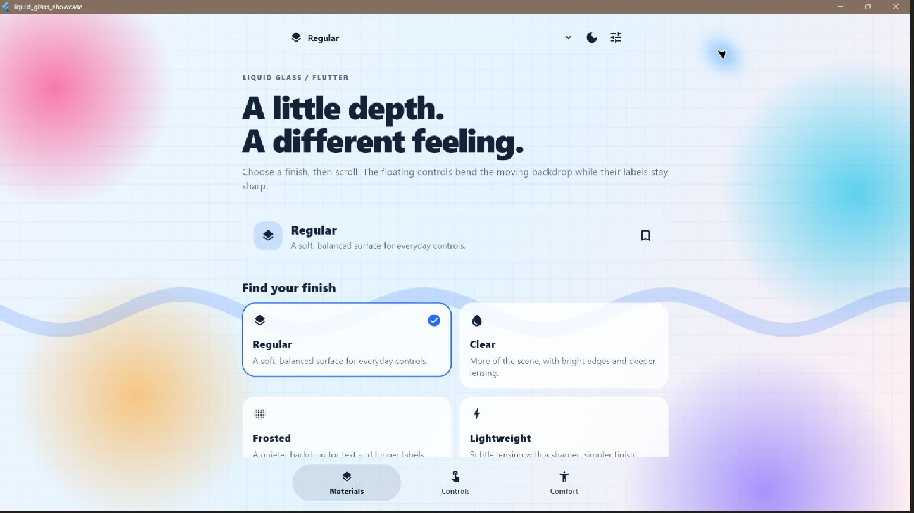
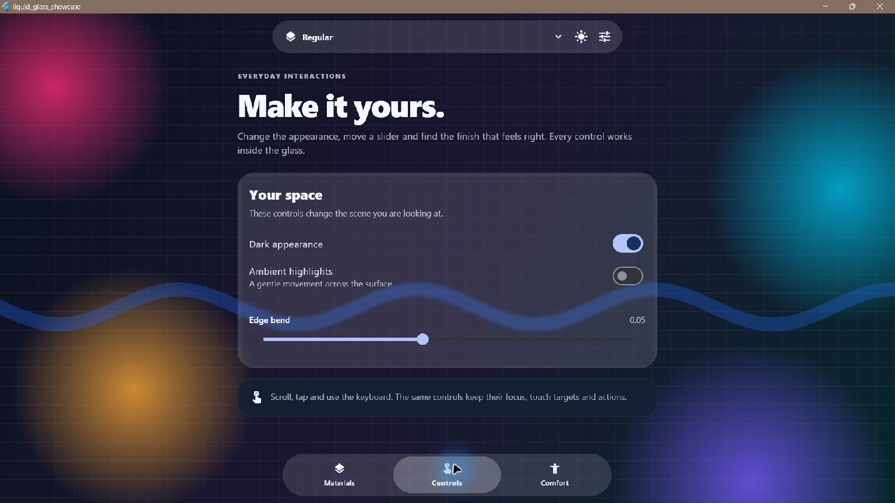
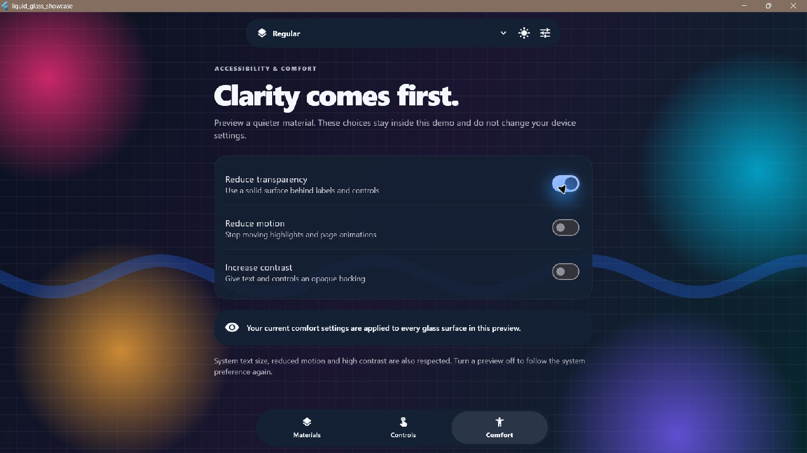

# liquid_glass_effect_flutter

Liquid glass surfaces for Flutter with refracted backgrounds, soft material
lighting, and crisp foreground controls.

**First prerelease: [0.1.0-dev.1](https://pub.dev/packages/liquid_glass_effect_flutter/versions/0.1.0-dev.1) · Flutter 3.32+ · BSD-3-Clause**



[Run the showcase](example/README.md) · [Integration guide](doc/INTEGRATION_GUIDE.md) ·
[Renderer compatibility](doc/COMPATIBILITY.md) ·
[Source](https://github.com/Keerthivasan-7/liquid_glass_effect_flutter)

## What it does

- **Refracts the scene:** geometry-aware edge lensing, blur, dispersion and
  directional highlights, with bounded texture sampling.
- **Keeps controls sharp:** glass samples a separate content plane; foreground
  text, icons and buttons keep their normal Flutter rendering and actions.
- **Offers four starting materials:** Regular, Clear, Frosted and Lightweight.
- **Adapts for comfort:** reduced motion, high contrast, explicit reduced
  transparency, and keyboard/accessibility focus feedback.
- **Reports its renderer:** observe capture, Impeller filter or fallback, plus
  capture bounds, generations and estimated image storage.

This is an independent screen-space material, not an Apple framework or a
claim of parity with Apple's compositor. The prerelease API and renderer
qualification are still evolving. See the compatibility notes below.

## Install

```yaml
dependencies:
  liquid_glass_effect_flutter: ^0.1.0-dev.1
```

```dart
import 'package:liquid_glass_effect_flutter/liquid_glass_effect_flutter.dart';
```

The GitHub repository, pub.dev package and primary Dart import are named
`liquid_glass_effect_flutter`.

## A complete example

`LiquidGlassScene` separates the refractable background from the glass layer.
Use it for floating controls, toolbars, navigation and small cards:

```dart
import 'package:flutter/material.dart';
import 'package:liquid_glass_effect_flutter/liquid_glass_effect_flutter.dart';

void main() => runApp(const MaterialApp(home: GlassExample()));

class GlassExample extends StatelessWidget {
  const GlassExample({super.key});

  @override
  Widget build(BuildContext context) => Scaffold(
        body: LiquidGlassScene(
          content: const DecoratedBox(
            decoration: BoxDecoration(
              gradient: LinearGradient(
                begin: Alignment.topLeft,
                end: Alignment.bottomRight,
                colors: [Color(0xFF61D9FF), Color(0xFF7457EC)],
              ),
            ),
            child: SizedBox.expand(),
          ),
          glass: Center(
            child: LiquidGlass(
              config: const LiquidGlassConfig.regular(),
              interactive: true,
              padding: const EdgeInsets.all(28),
              child: const Text(
                'Hello, glass',
                style: TextStyle(fontSize: 26, color: Color(0xFF142238)),
              ),
            ),
          ),
        ),
      );
}
```

Keep backgrounds in `content` and glass surfaces in `glass`. Surfaces share the
scene capture, while their children remain outside it. Ordinary child buttons
retain their callbacks and semantics. `interactive` adds visual feedback; the
surface itself does not consume the child's tap.

## Materials

| Showcase preset | Configuration | Starting point |
|---|---|---|
| Regular | `LiquidGlassConfig.regular()` | Balanced everyday controls |
| Clear | `LiquidGlassConfig.clear()` | More visible backdrop and stronger lensing |
| Frosted | `LiquidGlassConfig.frosted()` | More scattered backdrop beneath labels |
| Lightweight | `LiquidGlassConfig.performance()` | Simpler transmission sampling |

Use `copyWith` to tune blur, roughness, transmission, refraction strength,
thickness, dispersion, coating and lighting. Rounded rectangles, capsules and
circles are supported. Highlights are static by default; `animateLight: true`
opts into animation and respects reduced motion.

The Lightweight label describes its sampling settings, not a measured speed
ranking on every device. The [optics model](doc/PHYSICS_MODEL.md) documents the
material controls, and the showcase exposes the most useful adjustments.

## Explore the showcase



The example includes Materials, Controls and Comfort screens. Try the presets,
save a favorite for the session, adjust the optics, switch themes and preview
accessibility settings. Scroll the background behind the glass to see the
content-plane separation in action.

```sh
git clone https://github.com/Keerthivasan-7/liquid_glass_effect_flutter.git
cd liquid_glass_effect_flutter/example
flutter pub get
flutter run
```

## Accessibility



```dart
LiquidGlass(
  accessibility: const LiquidGlassAccessibilityPolicy(
    reduceTransparency: true,
    reduceMotion: true,
    // highContrast: null follows MediaQuery (the default).
  ),
  padding: const EdgeInsets.all(20),
  child: const Text('Readable controls'),
)
```

Reduced transparency or high contrast chooses an opaque theme surface without
capture, a shader or backdrop blur for that surface. `opaqueColor` overrides
the surface color. Motion follows `MediaQuery.disableAnimations`,
`accessibleNavigation`, and the explicit policy. Reduced transparency is an app
preference because Flutter does not expose a universal platform signal.

Keyboard focus within an interactive surface and accessibility focus on a
labeled surface get visible feedback. Inherited text/icon colors adapt to the
opaque surface; explicitly styled foreground content remains the app's
responsibility. Pause your app's own decorative animations separately.

## Renderer and platform limits

Inside a usable scene, `auto` prefers scoped capture. Without a scope, it can
select an engine-supported Impeller filter or clipped blur/tint fallback.
`onRenderPathChanged` reports the concrete path. Shader or capture failure
downgrades the effect; accessibility may intentionally choose opaque fallback.

The published renderer passed eighteen visual contracts on each of Windows/Skia,
a physical Android/Impeller GLES phone, CanvasKit and skwasm on 10 November 2026.
The phone and Windows also completed separate ten-minute foreground endurance
runs. The [source and result record](doc/evidence/2026-11-10/runtime-current/source-and-results.json)
ties these results to the published renderer, including the rotation-axis change.
Both SDK CI lanes and all three platform builds pass. The full phone matrix
collected 138 measurements: 34 of 46 groups met the fixed repeatability limits;
twelve did not. [All results, including failures](doc/evidence/2026-11-10/performance-physical-current/README.md)
are preserved. No renderer speedup or general frame-rate claim is made.
Protocol v7 removes periodic benchmark-display work; its
[four-case phone follow-up](doc/evidence/2026-11-10/performance-physical-v7-focused/README.md)
passes all twelve measurements. The remaining forty-two cases still need v7 qualification.

Physical iOS/Metal, Android Vulkan, macOS and Linux remain unverified. Overlapping
iOS filters require separate hardware evidence. The published platform list is
limited to Android, Windows and Web; use the exact scenarios and caveats in
[the compatibility matrix](doc/COMPATIBILITY.md) before selecting a target.

## Practical defaults

Keep glass surfaces small and share a scene among related controls. Distant
surfaces can make their rectangular capture union large. The default capture
`qualityScale` is 0.65; review changes on the intended device. Leave continuous
highlights off unless needed. Diagnostics estimate image storage, not GPU
memory or presentation FPS.

If only blur/tint appears, observe the active render path and accessibility
policy, and place glass inside a scene for scoped refraction. If edges clip,
leave space for optical displacement around the surface. Prefer the
Lightweight preset and smaller surface area when exploring cost tradeoffs.

## Documentation and license

- [App integration guide](doc/INTEGRATION_GUIDE.md)
- [Showcase instructions](example/README.md)
- [Capture sampling/resource contract](doc/CAPTURE_CONTRACT.md)
- [Compatibility and evidence](doc/COMPATIBILITY.md)
- [Performance protocol](doc/PERFORMANCE.md)
- [Reference research and attribution](doc/REFERENCE_COMPARISON.md)
- [Milestone progress](doc/MILESTONE_PROGRESS.md)
- [Release checklist](doc/RELEASE_CHECKLIST.md)

BSD-3-Clause. Reference libraries are not runtime dependencies, and their
implementation source was not copied into this package.
