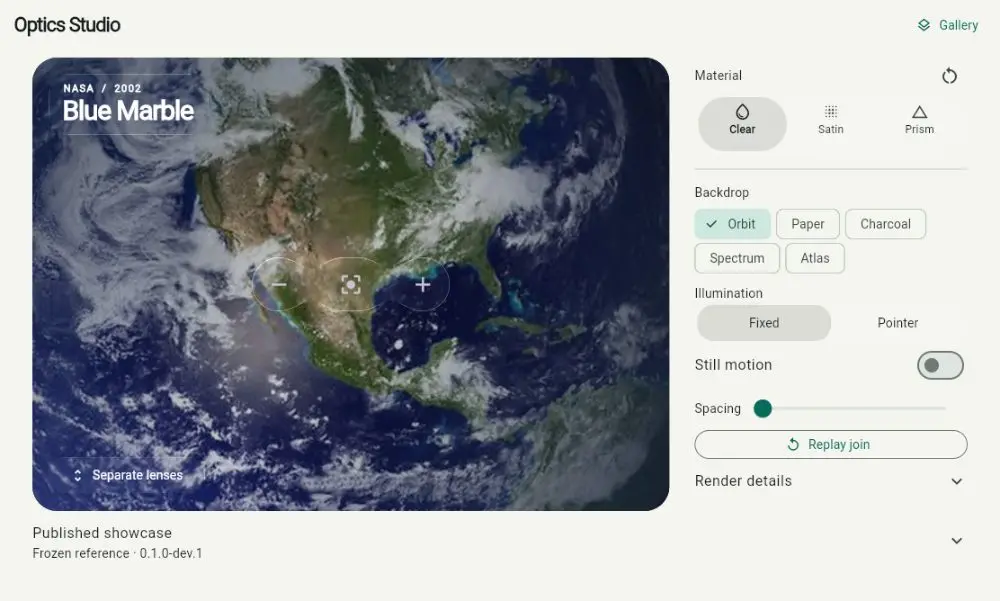

# Liquid glass showcase

Run `flutter pub get` and `flutter run` from this directory. The showcase uses
`LiquidGlassScene` to keep functional glass separate from its captured content.

The app opens in **Optics Studio**. Select Clear, Satin or Prism, then move the
spacing slider to separate the three camera controls and bring them back
together. The controls zoom or reset the backdrop. Try **Pointer** illumination
and drag across the scene, or select **Still motion**. **Replay join** repeats
the same transition from a fixed starting pose. **Render details** shows the
actual renderer and includes a large-text preview. **Published showcase**
opens a still from version 0.1.0-dev.1.



**Gallery** opens the three earlier destinations:

- **Materials:** choose Regular, Clear, Frosted or Lightweight. Save a favorite
  for this session, then use the top adjustment button for the fine controls.
  Reset restores the selected preset while preserving the ambient-highlight
  preference. Favorites and adjustments are not saved across app restarts.
- **Controls:** try an actual theme switch, optional ambient highlights and an
  edge-bend slider. Highlights start off and pause under reduced motion.
- **Comfort:** preview reduced transparency, reduced motion and high contrast
  throughout the showcase. Turn a preview off to follow the system preference
  again; reduced transparency is an app preference because there is no universal
  Flutter platform signal for it.

The background moves behind the glass as the page scrolls. Reduced motion keeps
that decoration still and removes the showcase's page transitions. The toolbar,
navigation and card controls stay in the foreground and remain sharp.
Fine adjustments contain an optional **Developer details** section; capture
notifications update that small label without rebuilding the full screen.

Regular is the default material. Lightweight maps to
`LiquidGlassConfig.performance()`; this name describes the preset's simpler
sampling settings, not a measured speedup on every device. See the
[integration guide](../doc/INTEGRATION_GUIDE.md) to use the package in an app.

## Delivery status

The 13 November 2026 handoff is a development package and showcase. The first
prerelease is published on pub.dev. Both hosted SDK lanes and Android, web and
Windows builds pass. The published renderer, including rotation-axis
precomputation, passes all eighteen visual contracts separately on physical
Android GLES, Windows/Skia, CanvasKit and skwasm. Separate ten-minute foreground
endurance runs pass on the phone and Windows. The full repeated phone timing
matrix collected all 138 measurements; 34 of 46 groups meet the fixed spread
limits and twelve remain unstable. Human showcase/accessibility review remains separate;
see [the current source and results](../doc/evidence/2026-11-10/runtime-current/README.md).

## Deterministic native contracts

```powershell
$env:LIQUID_GLASS_RESULTS = 'C:\absolute\path\to\results'
flutter drive --driver=test_driver/integration_test.dart --target=integration_test/renderer_contract_test.dart -d windows --profile --dart-define=RENDERER_LABEL=Windows-Skia
```

Replace the device and backend label with the observed target. Android can use
`-d emulator-5554`; verify the actual backend in device logs. Results contain
PNGs, concrete render paths, capture telemetry, and runtime metadata. Save the
SDK manifest, host/device details, and command log alongside them. The same
pixel assertions run as package tests; device results remain separate.

## Native lifecycle soak

```powershell
flutter drive --driver=test_driver/integration_test.dart --target=integration_test/renderer_soak_test.dart -d windows --profile --dart-define=SOAK_SECONDS=600 --dart-define=RENDERER_LABEL=Windows-Skia
```

The soak animates captured content, alternates one and four surfaces, repeatedly
disposes scopes, reads real image pixels to detect stale feedback, and records
tracked RGBA retention plus process RSS. A shorter `SOAK_SECONDS` is useful for
checking the harness but does not qualify the ten-minute gate. RSS includes the
engine and allocator caches; image estimates do not measure GPU driver memory.
Keep the app visible. The native soak imports `dart:io` and is not a web test.

Use `integration_test/renderer_qualification_test.dart` as the target to run
all eighteen visual contracts and the soak in one binary. Its export preserves
the earlier contracts and PNGs under `contracts/`, followed by the soak runtime
record. Check Android system services and crash logs as well as the app result;
a successful test with a failed Android system is not a clean endurance run.

These tools establish only the scenarios and backend they actually execute.
See [the compatibility matrix](../doc/COMPATIBILITY.md) for current evidence.

## Photographic accessibility checks

```powershell
flutter drive --driver=test_driver/integration_test.dart --target=integration_test/photo_accessibility_test.dart -d windows --profile --dart-define=RENDERER_LABEL=Windows-Skia
```

This separate fixture checks a 320 × 568 reading panel over a credited NASA
satellite-image composite. Its twelve cases combine light/dark surfaces,
explicit reduced transparency/inherited high contrast, and 1×/2×/3× text.
Exports contain top and scrolled-to-action images, contrast ratios, capture
counts, keyboard activation and semantics observations. The host rejects a
partial matrix. Package tests exercise the same assertions with the widget
test font; native captures use the platform font.

The example supplies matching button colors and a scrollable content layout.
These checks apply to opaque reading modes. They do not establish arbitrary
translucent text contrast, screen-reader usability or human product approval.
The image credit and source are in [assets/README.md](assets/README.md).

## Android surface readback and app reuse

Android qualification uses the example's small native bridge to copy its own
presented Flutter SurfaceView with
[PixelCopy](https://developer.android.com/reference/android/view/PixelCopy).
It does not convert the surface to an ImageView. This avoids depending on the
offscreen image-readback path that stalled on the connected Android 10 phone.
That diagnostic does not qualify the phone's renderer. PixelCopy itself is a
test readback operation, so these runs are not performance measurements.

Build the profile qualification binary once, then run from the source checkout:

```powershell
flutter build apk --profile --target=integration_test/renderer_qualification_test.dart --target-platform=android-arm,android-x64
./tool/run_android_qualification.ps1 -Flutter flutter -Adb adb -Device DEVICE -Binary build/app/outputs/flutter-apk/app-profile.apk -OutputDirectory C:/absolute/results -Route '/?mode=contracts'
```

Use `/?mode=soak&seconds=10` for a harness probe and
`/?mode=soak&seconds=600` for the ten-minute window. The launcher verifies the
installed APK hash, reuses it across routes, retains VM-service authentication,
and stops only this test app afterward. It never uninstalls the app. The
developer activity keeps its own window awake while visible; it does not change
the phone's screen-timeout setting. API 24+ and a visible SurfaceView are required.
